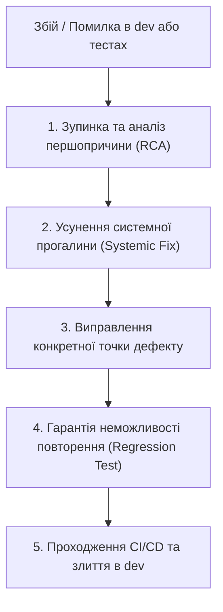

# Протокол виправлення помилок на етапі розробки (Development RCA Protocol)

## Головний архітектурний принцип: «Усунення першопричини, а не симптому» (Root-Cause First)

Будь-який збій, логічну помилку або дефект, виявлені на етапі розробки чи тестування у контурі Antigravity, **заборонено виправляти локальними латками (quick-fixes / костилями)** на зразок сліпих блоків `try-except pass` чи повернення пустих значень замість валідації.

---

## Етапи інженерного алгоритму усунення дефектів:

### 1. Зупинка та аналіз першопричини (Root Cause Analysis - RCA)
- **Помилковий підхід:** Написати блок `try-except: pass`, який просто проковтне помилку або поверне заглушку.
- **Правильний підхід:** З'ясувати фундаментальну причину — чому система очікувала один формат або стан, а отримала інший? Чому контракт, схема чи стан дозволили цьому статися?

### 2. Усунення системної прогалини (Systemic Fix)
- Виправляємо не просто виклик у конкретній функції, а **архітектурний контракт**:
  - Додаємо суворі Pydantic v2 моделі;
  - Посилюємо типізацію (MyPy / strict type hints);
  - Забезпечуємо валідацію вхідних даних на рівні базового класу, щоб унеможливити прийняття невалідних даних на рівні всієї бібліотеки для будь-яких майбутніх модулів.

### 3. Виправлення самого дефекту
- Тільки після закриття системної архітектурної діри виправляється конкретна точка виникнення багу.

### 4. Гарантія неможливості повторення (Regression Lock)
- Пишеться обов'язковий **ізольований юніт-тест (`pytest`)**, який штучно та детерміновано відтворює саме цей краш-кейс.
- Тест вшивається у загальний тестовий набір. Код не перейде з гілки `dev` у реліз, доки тест не пройде успішно.

---

## Баланс детермінованості та гнучкості в розробці коду

- **Детерміноване в розробці (Жорсткі правила):**
  - Стандарти коду та лінтери (`ruff`).
  - Правило 100% типізації (код без явних типів не проходить перевірку).
  - Пайплайн Git Flow: заборона комітити в обхід гілки `dev` та обов'язкових автоматичних тестів.
- **Гнучке в розробці (Простір для творчості):**
  - Архітектура плагінів: розробка нових фіч через чітко визначені абстрактні класи та інтерфейси без зламу стабільного ядра.
  - Промпти та логіка адаптації контенту: налаштування під окремі канали без потреби переписувати рушій бібліотеки.
