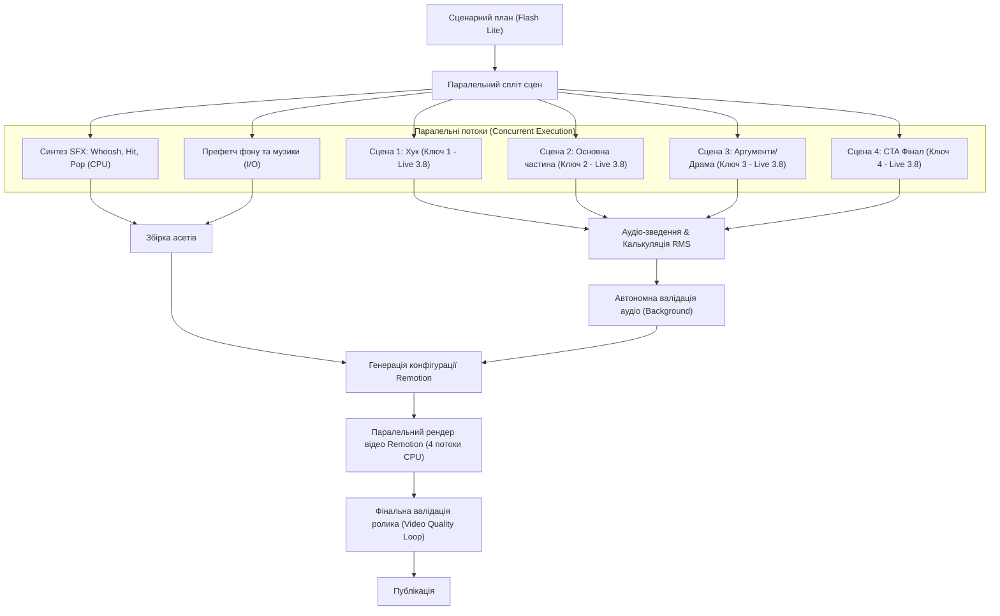

# Паралелізм, квоти та технічні ліміти пайплайну Jemini

Цей документ формалізує архітектурні ліміти моделей, протоколів та інфраструктури, а також визначає, **які саме етапи конвеєра виконуються паралельно** для досягнення максимальної швидкості та стійкості.

---

## 1. Офіційні ліміти та обмеження системи

### А. Обмеження тривалості Gemini Live API
- **Audio-only сесії (без стиснення):** максимум **15 хвилин** безперервного WebSocket з'єднання. Після цього сесія примусово розривається сервером.
- **Audio-video сесії (без стиснення):** максимум **2 хвилини**.
- **Фізичний час життя з'єднання (Connection Lifetime):** близько **10 хвилин**, після чого сервер надсилає `GoAway` повідомлення.
- **Швидкість накопичення токенів (Token Rate):** аудіо генерує приблизно **25 токенів на секунду** (~1,500 токенів за хвилину мовлення).
- **Відеофрейми:** обмеження $\le 1$ FPS (JPEG).
- **Частота дискретизації:** вихід 24kHz 16-bit Mono PCM; вхід 16kHz 16-bit Mono PCM.

### Б. Ліміти моделей Free-Tier та розрахунок пулу (на 5 ключів)

| Модель | RPM (на ключ) | RPD (на ключ) | Пул 5 ключів (RPD) | Призначення |
| :--- | :---: | :---: | :---: | :--- |
| **`gemini-3.8-live`** | **Необмежено** | **Необмежено** | $\infty$ (65K TPM) | Жива озвучка TTS, стрими, відео-аудит |
| **`gemini-3.1-flash-lite`** | 15 | 500 | **2 500 RPD** | Сценарії, аналітика, валідація, роутинг |
| **`gemini-3.5-flash-lite`** | 15 | 500 | **2 500 RPD** | Швидкі перевірки, текстова обробка |
| **`gemini-3.8-flash`** | 5 | 20 | 100 RPD | Складне стратегічне планування |
| **`gemini-embedding-2`** | 100 | 1 000 | **5 000 RPD** | Векторна пам'ять pgvector (768-dim) |
| **`gemini-3.8-flash-tts`** | 3 | 10 | 50 RPD | *Резервний* unary TTS (суворе читання) |

### В. Ліміти рендерингу (Remotion / FFmpeg / Docker)
- **Паралелізм рендерингу кадрів:** рекомендовано `concurrency: 4-8` потоків на процес Chromium.
- **Оперативна пам'ять:** $\approx 1.2$ ГБ RAM на кожен headless-процес Chromium.

---

## 2. Карта паралельного виконання пайплайну (Concurrency Map)

### Деталізація паралельних зон:
1. **Зона 1: Мульти-сценний синтез голосу (`asyncio.gather`):**
   - Ролик розбивається на сцени (наприклад, 4 сцени по 5-8 секунд).
   - Завдяки нашому пулу з 5 ключів, усі 4 сцени синтезуються **одночасно за різними сесіями**.
   - *Ефект:* час генерації голосу скорочується з 30-40 секунд до 6-8 секунд.
2. **Зона 2: Паралельна підготовка звукових та візуальних асетів:**
   - Поки мережевий WebSocket Live API пише звук, локальний процесор генерує процедурні ефекти (`whoosh`, `hit`, `pop`) та зчитує з кешу графіку.
3. **Зона 3: Фонова валідація (Background Validation):**
   - Валідація не блокує підготовку наступного етапу; перевірка звуку та сценарію йде паралельно з компонуванням сцени.
4. **Зона 4: Рендеринг відео (Remotion Concurrency):**
   - Рендерер ділить відео на пачки кадрів (chunks) і рендерить їх у паралельних інстансах Chromium.

---

## 3. Захист від перевищення ліміту тривалості (Session Guard)
1. **Чанкування довгих текстів (Chunking):** Тексти тривалістю $>3$ хвилин автоматично розбиваються на сценарні блоки $\le 90$ секунд.
2. **Resumption & Safe Disconnect:** WebSocket з'єднання ніколи не тримається відкритим у режимі очікування; з'єднання відкривається під конкретний чанк і закривається одразу після отримання останнього фрейму (`turn_complete`).
3. **Failover Timeout:** Якщо WebSocket не надсилає чанки більше 4.0 секунд, сесія скидається і перемикається на Hot Standby ключ.
