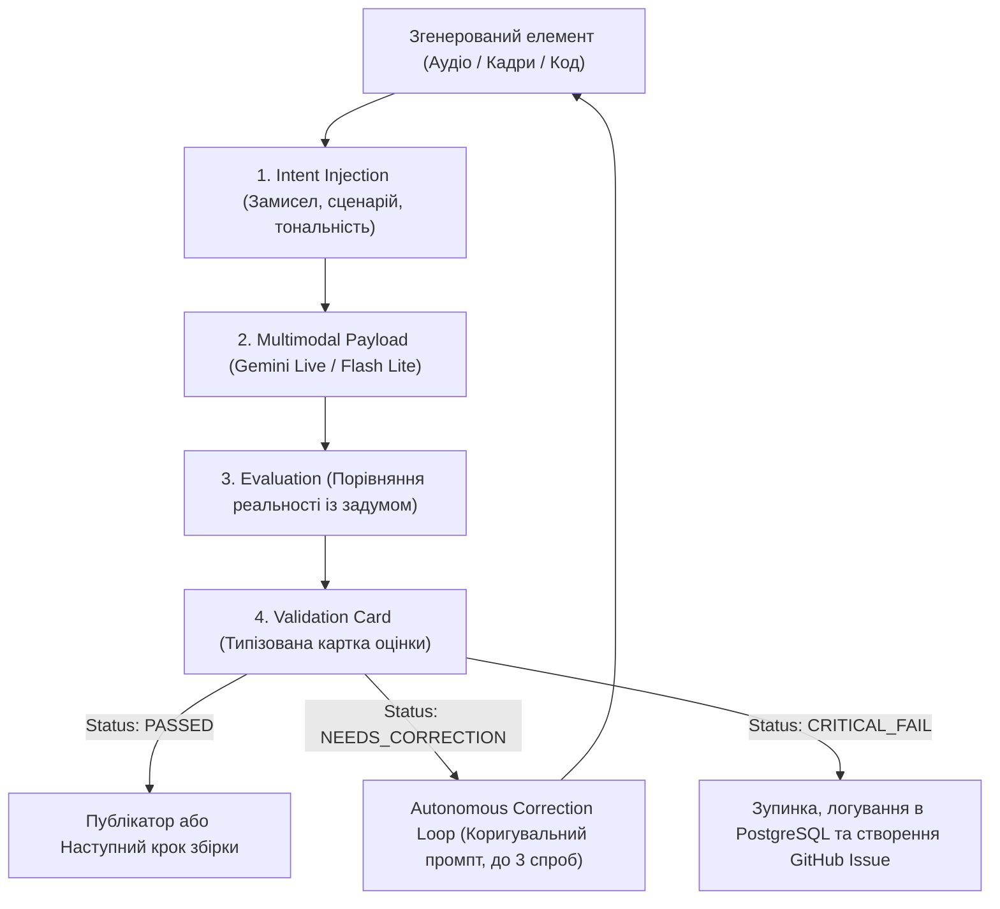

# Специфікація модуля: Перевірка медіаданих та контролю якості (Media Validation Engine)

## 1. Призначення та концепція
Перед відправленням будь-якого згенерованого матеріалу (відеоролик, аудіодоріжка, озвучка, код, графічні елементи) у реліз або на публікацію (YouTube, TikTok), система пропускає його через контур мультимодальної перевірки.

Двигун **Gemini Live API / Multimodal Engine** використовується як «віртуальний арт-директор» та «контролер якості» (Quality Control Loop), який автономно порівнює фактичний результат із початковим технічним завданням, сценарієм та стилістикою каналу в режимі **Zero-Human-In-The-Loop**.

---

## 2. Пайплайн перевірки (Media Quality Loop)

1. **Передача контексту (Intent Injection):** Передача моделі початкового плану: текстовий опис, сценарний план, ключові акценти, цільова емоція (за Golden Acting Standard), таймінги.
2. **Потокова подача медіа (Payload):** Згенерований медіафайл (PCM аудіодоріжка, ключові JPEG кадри відео або код компонента) передається на аналіз.
3. **Аналіз та оцінка (Evaluation):** Порівняння медіаряду із заданим планом за чіткими критеріями.
4. **Формування картки (Validation Card):** Вихідний результат повертається у суворому форматі JSON (`ValidationCard`).

---

## 3. Критерії перевірки для різних типів медіа

### Для відео та відеорядів:
- Відповідність візуального ряду сценарному плану.
- Відсутність артефактів, змазаних кадрів чи порушень палітри каналу.
- Рівень динаміки, дотримання 3-секундного правила хука та тривалості.

### Для аудіо та TTS (озвучки):
- Відповідність голосу заданому архетипу (`Zephyr`, `Aoede`, `Fenrir`, `Kore`).
- Дотримання **Golden Acting Standard**: живі смішки, vocal fry, шепіт, відсутність синтетичного «ха-ха».
- Чистота звуку (24kHz 16-bit PCM), відсутність кліпінгу чи неприродних обривів.

### Для інтерактивних елементів та коду:
- Коректність накладання субтитрів, поп-ефектів та караоке-таймінгів.
- Відповідність згенерованого коду компонентів стандартам типізації.

---

## 4. Дії за результатами картки (Validation Actions)

- **Статус `PASSED`:** Контент без затримок передається до модуля публікатора (YouTube Shorts / TikTok).
- **Статус `NEEDS_CORRECTION`:** Система автоматично витягує зауваження з картки, формує коригувальний промпт і повторно запускає генерацію (до 3 ітерацій) без участі людини.
- **Статус `CRITICAL_FAIL`:** Процес зупиняється, картка помилки записується в `channel_audit_logs` у PostgreSQL, генерується GitHub Issue для розробки.

---

## 5. Застосування архітектурного принципу (Root-Cause First)
Якщо система фіксує повторювані помилки валідації:
- Заборонено просто збільшувати ліміт спроб перегенерації (латати симптом).
- Проводиться Root Cause Analysis: аналізується, чому базові системні інструкції чи типізація допустили брак, вносяться зміни в архітектурний контракт у `DevelopmentBrain`, і лише після цього відновлюється автономний конвеєр.
